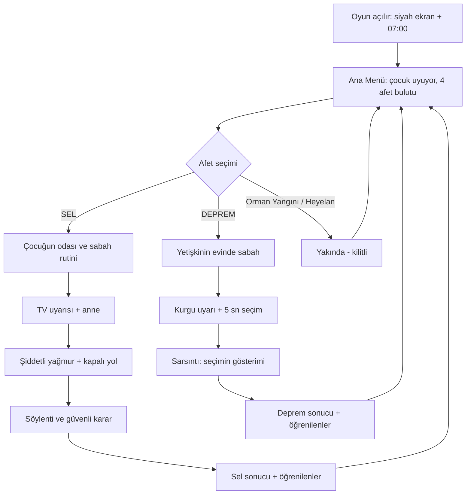

# Game Design Document (GDD) — AFET UYANIŞI

> ⚠️ **GÜNCEL DEĞİL — paketin ilk tasarımı.** Bağlayıcı akış, kararlar ve ID'ler: [`docs/OYUN_AKISI.md`](OYUN_AKISI.md). Çelişki varsa OYUN_AKISI geçerlidir (ör. deprem artık aynı çocuğun evinde geçer, anne uyarıyı küçümsemez).

**Sürüm:** 2.0 · **Kapsam:** 48 saat · **Hedef platform:** Windows PC · **Oyun motoru:** Unity 2D/C# · **Görsel:** sinematik modern pixel art · **Dil:** Türkçe

## 1. Tek cümlelik konsept

Bir çocuk uyurken gördüğü afet rüyalarından iki hikâyeyi deneyimlediğimiz; **uyarıları doğru yorumlama, doğrulanmış bilgi arama ve afet anında güvenli karar alma** temalı kısa, interaktif hikâye oyunu.

## 2. Oyuncu kim? Ne yapar?

- **SEL:** 10–12 yaşlarında bir çocuk. Sabah okul hazırlığı yaparken şiddetli yağış uyarısını öğrenir; annesi uyarıyı önemsemez. Okula gidiş yönünde yollar kapanır. Arkadaşlar telefon haberlerini farklı aktarır; oyuncu söylentiyle doğrulanmış bilgiyi ayırıp güvenli hareket eder.
- **DEPREM:** Başka bir evde yaşayan yetişkin. Sıradan bir sabah sırasında kısa bir kurgu uyarısı görünür, ardından sarsıntı başlar. Oyuncu beş hareketten birini **5 saniye içinde** seçer. Doğru seçenek sarsıntı sırasında güvenli davranışı uygulamaktır.

Oyunun amacı oyuncuya salt bilgi ezberletmek değil, **kararın sonuçlarını güvenli ve yaşa uygun biçimde göstermek**.

## 3. Tasarım ilkeleri

1. **Her 15–30 saniyede anlamlı gelişme:** kısa sahne, diyalog, seçim, geri bildirim.
2. **Uyarı → yorum → karar → sonuç** dört adımlı döngü iki afette de tekrar eder.
3. **Başarısızlık öğreticidir; cezalandırıcı değil:** yanlış seçenek anlık uyarı ve güvenli davranış açıklaması getirir, uzun ölüm/gore gösterimi yoktur.
4. **2D side view / sabit kamera:** kısa, okunabilir sahneler; devasa açık dünya yok.
5. **Hızlı üretim:** minimum el yapımı animasyon; parallax, Tween/Coroutine, CanvasGroup ile etkiler.
6. **Yüksek okunabilirlik:** Türkçe karakter desteği, minimum UI öğesi ve kontrol ipuçları.

## 4. Oyuncu yolculuğu / ekran akışı

## 5. Ana menü — sinematik akış

- **0.0–1.0 sn:** oda karanlık; kırmızı `07:00` görülebilir.
- **1.0–2.0 sn:** odanın sabah ışığıyla belirginleşmesi, çocuk yatakta uyur.
- **2.0–4.0 sn:** dört bulut sıralı görünür: Deprem, Sel, Orman Yangını, Heyelan.
- **4.0–5.0 sn:** başlık ve Yeni Oyun / Ayarlar / Çıkış ortaya çıkar.
- Döngü: çocuk nefes alır, saat hafif parlar, bulutlar yukarı-aşağı 1–2 piksel hareket eder.
- Seçilebilir: SEL ve DEPREM. Diğer ikisi kilitli açıklaması gösterir.
- Klavye `A/D` veya oklar bulut seçimi; `Enter` oyun başlatma; `Esc` ayarlardan çıkış; mouse tıklama destekli.
- Intro Space ile atlanabilir. Seçili başlangıç: SEL.

## 6. Sel bölümü — önerilen 2–4 dakika

| Sahne | Hedef | Etkileşim | Gereken minimum görsel |
|---|---|---|---|
| F01 Bedroom | Çocuk uyanır | `E - Kalk`, yataktan kalkma | Oda, yatak/çocuk |
| F02 Bathroom | Sabah rutini | Lavaboya gel, E ile yüz yıka | Banyo kartı/sabit arka plan |
| F03 News + Mother | Uyarının anlaşılmaması | Haber izleme, anneye soru, bilgi kararı | TV, anne sprite, diyalog UI |
| F04 Rainy Street | Yağmur şiddetlenir | Kısa yürüyüş, yağmur görseli | Yağmurlu sokak |
| F05 Blocked Road | Araçlar durur, yol kapanır | Arkadaşlardan duyulan iddialar | Yol, arabalar, bariyer |
| F06 Decision | Kaynak ve güvenlik seçimi | Güvenli rota/yetkili bilgi seçimi | 2–3 seçenekli karar paneli |
| F07 Result | Mesaj ve sonuç | Yeniden oyna / menü | Sonuç arayüzü |

**Kritik küçük kapsam:** F01+F02 aynı oda/oynanış akışında tek etkileşim animasyonu olabilir; F03 TV/anne tek mekân; F04–F06 aynı yağmurlu sokak arka planında farklı overlay'lerle ilerleyebilir. Ama hikâyenin tüm anlamları gösterilir.

**Örnek iki karar:**
1. “Annem 'normal yağmur' diyor, ne yapmalıyım?” → resmi uyarıyı ve önerileri kontrol et (doğru), haberi yok say (yanlış), kaynağı belirsiz paylaşımla yetin (yanlış).
2. “İleri yol suyla dolmuş ve arkadaşlar farklı şeyler söylüyor.” → su basmış yola girmeden güvenli alanda kalıp resmî kaynak/yetkililere bak (doğru), suyun içinden geç (yanlış), söylentiye güvenip kapanan yola yönel (yanlış).

## 7. Deprem bölümü — önerilen 1–2 dakika

**Amaç:** Sarsıntı başladığında güvenli davranışa hızlı geçmeyi öğrenmek.

1. Yetişkin evde eşini selamlar, kısa gündelik yaşam görüntüsü.
2. Telefonda/TV'de **kurgu amaçlı** uyarı olur; ertesi saniyelerde sarsıntı başlar. Bu erken uyarı bir garanti gibi sunulmaz.
3. Kamera sabit; **5 büyük seçenek** erişilebilir. `5 → 0` sayacı. Seçim için `1–5` veya mouse.
4. En doğru davranış: **sağlam bir masa altına/yanına güvenli şekilde çöküp baş-boynu korumak, tutunmak**; mekan seçimi gerçek koşullara uygun olmalı. Bir masa seçenek 1 için görünür olmalı.
5. Yanlış seçeneklerde oyuncu tehlikeli hareketi uzun uzun canlandırmaz; hızlı bir durdurma/uyarı overlay'i gelir: “Bu güvenli değil; sarsıntı sırasında koşmak, merdivene/asansöre gitmek risklidir.”
6. Sarsıntı görseli: düşük güçlü kamera sarsıntısı, rafın sallanması, ses. **Şiddetli flaş/gore yok.**
7. Sonuç ekranı: doğru yaklaşımın kısa açıklaması ve tekrar oynama.

**5 seçenek önerisi (ekrandaki okunur kısa etiket):**
- 1. `Sağlam masanın altına Çök–Kapan–Tutun` (**doğru**)
- 2. `Pencereye koş` (yanlış)
- 3. `Merdivene koş` (yanlış)
- 4. `Asansöre yönel` (yanlış)
- 5. `Balkona çık` (yanlış)

**Süre biterse:** oyuncu yerinde kalıp başını korumasını anlatan anlık bilgi alır ve yeniden dener. Zaman baskısını erişilebilir kılmak için başlık/5 seçenek sarsıntıdan *önce* görünür, oyuncuya anında okunabilir arayüz sunulur. Oyun gerçek güvenlik eğitiminin yerine geçmez.

## 8. Teknik uygulama için ortak mantık

- Tek `MainMenu` sahnesi; ayrı `FloodChapter` ve `EarthquakeChapter` sahneleri; `ResultPanel` ortak prefab olabilir.
- Diyalog metinleri `data/` örneklerini referans alır; K4 içerik sahibi, K2/K3 ilgili sahneye bağlar.
- `ChapterId` yalnızca `Flood`, `Earthquake`, `Wildfire`, `Landslide` id'lerini taşır; son ikisi `locked=true`.
- `GameManager`/scene routing yalnız K1 tarafından değiştirilir; K2/K3 kendi sahnelerini tamamlanınca K1'e teslim eder.
- `Audio`: 1 menü ambience, 1 yağmur loop, 1 uyarı sesi, 1 düşük yoğunluklu deprem rumble yeterlidir.

## 9. P0 kabul kriteri

- Menü, Sel ve Deprem art arda oynanabilir.
- En az 2 Sel kararı, 1 Deprem zamanlı karar uygulanmıştır.
- İki bölümün de sonuç ekranı vardır.
- Orman yangını/heyelan henüz açılmaz, yanlışlıkla boş sahneye gitmez.
- Ekip herhangi bir anda son başarılı Windows build'ini açıp gösterebilir.

## 10. 48 saat dışı fikirler (bilerek yapılmayacak)

Uzun envanter, çoklu sonlar (basit yorum farkı hariç), online leaderboard, kayıt sistemi, seslendirme, serbest açık şehir, üç boyutlu fizik, karmaşık ragdoll, multiplayer, tam orman yangını/heyelan bölümleri, foto-gerçekçi sinematik video. Jam bitince değerlendirilecek.
