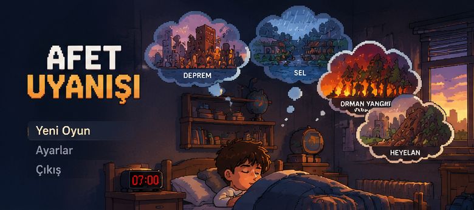
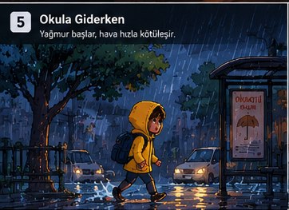
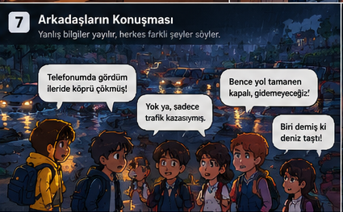

# Asset Manifest — gerçek dosyalar ve hazırlık notları

**Önemli:** Ekli görseller konsept/pixel-art illüstrasyonlarıdır. Pakette gerçek Unity `.unity` scenes, C# scripts, timeline animasyon klipleri ve test edilmiş oyun build sürümü **yoktur**. Çoğu ayrı PNG, ancak yürüyüş/koşu pozları hizalı çok kareli sprite sheet değildir.

| Dosya | Boyut | Arka plan | Kullanım / dikkat |
|---|---:|---|---|
| [CONCEPT_Full_Game_Board.png](concept/CONCEPT_Full_Game_Board.png) | 1536×1024 | opaque | Full game concept board; not a working Unity screenshot. |
| [CONCEPT_Intro_Storyboard.png](concept/CONCEPT_Intro_Storyboard.png) | 1536×1024 | opaque | Five-panel flood introduction story; illustration only. |
| [CONCEPT_Original_User_Board.png](concept/CONCEPT_Original_User_Board.png) | 1536×1024 | opaque | Original user-supplied pixel art concept board. |
| [CONCEPT_Asset_Overview.png](concept/CONCEPT_Asset_Overview.png) | 1536×1024 | opaque | Visual catalog, not a uniformly sliced animation sprite sheet. |
| [BG_Bedroom_Sunrise.png](backgrounds/BG_Bedroom_Sunrise.png) | 1672×941 | opaque | Bedroom painted background, includes bed & clock as baked pixels. |
| [CHR_Boy_Sleep_Bed.png](sprites/CHR_Boy_Sleep_Bed.png) | 1254×1254 | alpha | Sleeping boy with bed, RGBA. May overlap background bed. |
| [CHR_Boy_Idle_Yellow.png](sprites/CHR_Boy_Idle_Yellow.png) | 1254×1254 | alpha | Boy idle pose, RGBA; high-resolution stand-in, not sprite-sheet frame. |
| [CHR_Boy_Walk_Yellow.png](sprites/CHR_Boy_Walk_Yellow.png) | 1254×1254 | alpha | Boy walking pose RGBA; separate pose. |
| [CHR_Boy_Run_Yellow.png](sprites/CHR_Boy_Run_Yellow.png) | 1254×1254 | alpha | Boy running pose RGBA; separate pose. |
| [CHR_Boy_Interact_Yellow.png](sprites/CHR_Boy_Interact_Yellow.png) | 1254×1254 | alpha | Boy interacting pose RGBA. |
| [CHR_Boy_Question_Portrait.png](sprites/CHR_Boy_Question_Portrait.png) | 1254×1254 | alpha | Boy dialogue portrait question RGBA. |
| [CHR_Boy_Worried_Portrait.png](sprites/CHR_Boy_Worried_Portrait.png) | 1254×1254 | alpha | Boy worried portrait RGBA. |
| [CHR_Mother_Talking.png](sprites/CHR_Mother_Talking.png) | 1086×1448 | alpha | Mother speaking RGBA, single pose. |
| [CHR_Mother_Idle_Portrait.png](sprites/CHR_Mother_Idle_Portrait.png) | 1254×1254 | alpha | Mother portrait RGBA. |
| [UI_Title_Afet_Uyanisi.png](ui/UI_Title_Afet_Uyanisi.png) | 1448×1086 | alpha | Title art RGBA. |
| [UI_Clock_0700.png](ui/UI_Clock_0700.png) | 1254×1254 | alpha | Digital alarm clock 07:00 RGBA. |
| [UI_Bubble_Earthquake.png](ui/UI_Bubble_Earthquake.png) | 1448×1086 | alpha | Earthquake thought bubble RGBA. |
| [UI_Bubble_Flood.png](ui/UI_Bubble_Flood.png) | 1448×1086 | alpha | Flood thought bubble RGBA. |
| [UI_Bubble_Wildfire_LOCKED.png](ui/UI_Bubble_Wildfire_LOCKED.png) | 1448×1086 | alpha | Wildfire concept bubble RGBA, locked in P0. |
| [UI_Bubble_Landslide_LOCKED.png](ui/UI_Bubble_Landslide_LOCKED.png) | 1448×1086 | alpha | Landslide concept bubble RGBA, locked in P0. |
| [UI_MenuButtons_REFERENCE.png](ui/UI_MenuButtons_REFERENCE.png) | 1086×1448 | alpha | Three menu buttons in a single PNG; not 3 independently clickable Unity Buttons. |

## İlk kullanılacak 8 parça

1. `backgrounds/BG_Bedroom_Sunrise.png` — menü arka plan.
2. `sprites/CHR_Boy_Sleep_Bed.png` — uyuyan çocuk + yatak (çifte yatak görüntüsünü çöz).
3. `ui/UI_Clock_0700.png` — ayrı saat (arka planda saat zaten varsa üst üste gelmesin).
4. `ui/UI_Bubble_Earthquake.png` — açık bölüm.
5. `ui/UI_Bubble_Flood.png` — açık bölüm.
6. `ui/UI_Bubble_Wildfire_LOCKED.png` — kilitli bölüm.
7. `ui/UI_Bubble_Landslide_LOCKED.png` — kilitli bölüm.
8. `ui/UI_Title_Afet_Uyanisi.png` — başlık.

## Concept preview kartları

## Eksik ama üretilecek oyun assetleri

- `BG_Flood_RainyStreet`: hikâye sahnesi için tek geniş arka plan (mevcut dosyalar yalnız konsept board kırpıntısı).
- `BG_Earthquake_LivingRoom`: sağlam masa ve pencereyi aynı karede gösteren yeni arka plan (pakette henüz **yok**).
- `CHR_Adult_Earthquake_Idle` ve `CHR_Adult_DropCoverHold`: deprem bölümüne özgü yetişkin sprite (henüz **yok**).
- `UI_ResultPanel`, UI fontu, gerçek tıklanabilir Button prefabları ve gerçek sprite animation frames (henüz **yok**).
- Sesler: lisanslı/özgün menu ambiance, rain loop, earthquake rumble (henüz **yok**).

**Dosyayı içeri aktarırken:** Unity Sprite Importer, `Filter Mode = Point`, `Compression` düşük/yok, `Mipmap = off`. UI görsellerinde gerçek alpha var, fakat kenarlarda yarı-saydam antialias bulunabilir; görsel kaliteyi 640×360 test edin.
